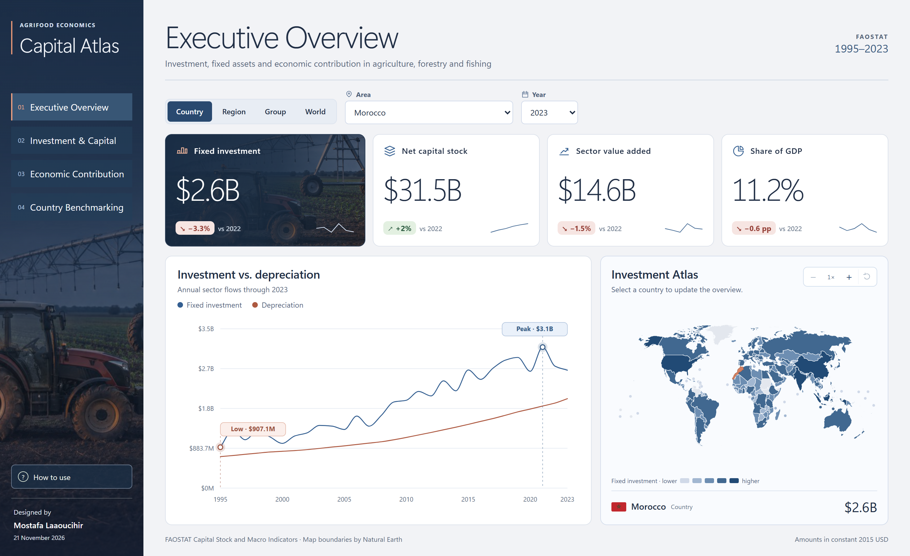
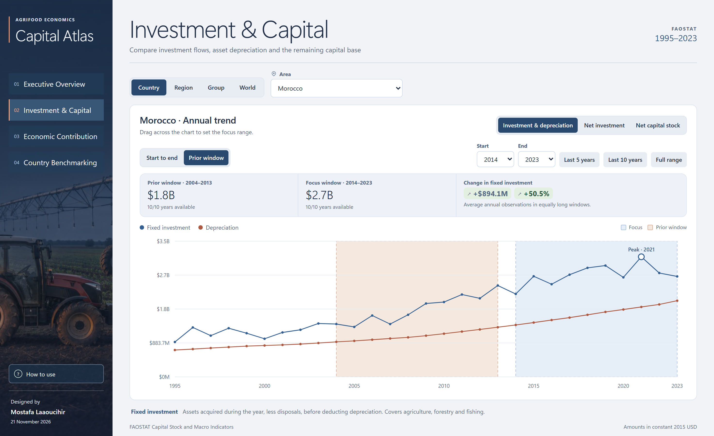
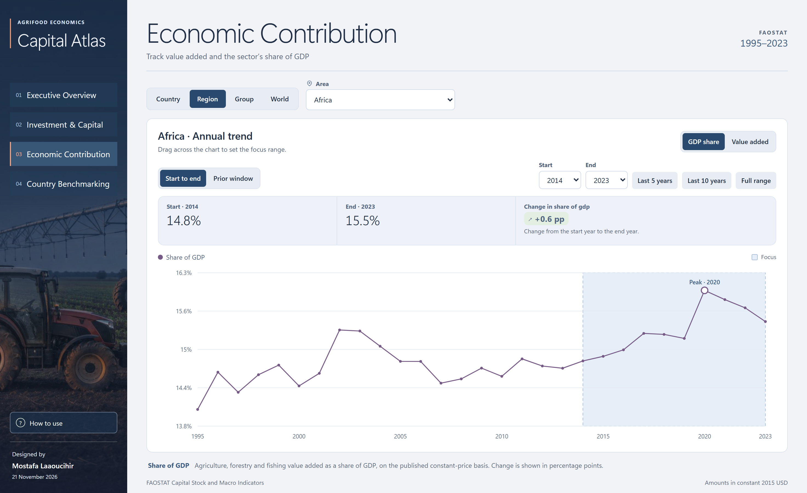
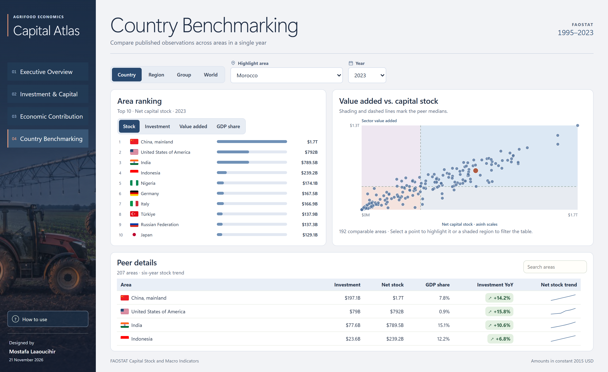

# Capital Atlas

Capital Atlas is a four-page Power BI report on fixed investment, depreciation, asset stocks and economic contribution in agriculture, forestry and fishing. It combines two FAOSTAT releases in an annual area-level model.

## Dashboard gallery

### Investment & Capital

Morocco’s fixed investment and depreciation, with two consecutive ten-year windows highlighted.

### Economic Contribution

Agriculture, forestry and fishing as a share of Africa’s GDP, with the 2014–2023 change shown in percentage points.

### Country Benchmarking

The 2023 ranking by net capital stock, median-based peer quadrants, and country-level trends.

## Open and refresh

1. Open `Capital Atlas.pbip` in Power BI Desktop. Keep it alongside both companion folders.
2. Download and extract the normalized **All Data** CSVs from [Capital Stock](https://www.fao.org/faostat/en/#data/CS) and [Macro Indicators](https://www.fao.org/faostat/en/#data/MK).
3. Place both CSVs next to the supplied `area_flags.csv` in a local data folder. Keep these filenames.

   - `Investment_CapitalStock_E_All_Data_(Normalized).csv`
   - `Macro-Statistics_Key_Indicators_E_All_Data_(Normalized).csv`
   - `area_flags.csv`

4. In Power BI Desktop, set **DataFolder** under **Home → Transform data → Edit parameters**. Enter the absolute path of that data folder, then refresh the report.

The Git source archive contains the report, model definitions, flag lookup and visual source. Download the two FAOSTAT CSVs to refresh a fresh checkout. The snapshot used for development contains 144,944 capital stock rows and 708,632 macro rows. Newer FAOSTAT releases can revise historical values. The report currently displays the shared **1995–2023** window. See the [model and methodology notes](docs/methodology.md) for the KPI definitions and validation checks.

## Explore the report

| Page | What you can do |
| --- | --- |
| Executive Overview | Select an area and year, click the map to filter, zoom and pan, and flip the investment card to read the year’s result in context. |
| Investment & Capital | Compare fixed investment with depreciation and examine net investment and capital stock. Select two years or drag across the trend. |
| Economic Contribution | Switch between sector value added and the sector’s share of GDP, then compare endpoints or equal-length annual windows. |
| Country Benchmarking | Compare the Top 10 for a selected indicator, explore median quadrants, and scroll or search the peer details table. |

In Power BI Desktop edit mode, use **Ctrl+click** on a sidebar button to navigate. **How to use** opens a guide from any page.

## Project layout

| Path | Purpose |
| --- | --- |
| `Capital Atlas.Report/` | Report pages, navigation and registered HTML, CSS and SVG visuals |
| `Capital Atlas.SemanticModel/` | TMDL model, Power Query transformations, relationships and DAX measures |
| `visuals/` | Editable visual source and local image, boundary and flag assets |
| `scripts/rebuild_visuals.py` | Rebuilds the four registered visual resources from source using Python 3 and its standard library |
| `checks/model-smoke-test.dax` | Row counts and a known-value check for the development snapshot |
| `docs/methodology.md` | Model design, metric definitions, refresh behavior and performance notes |

To change a visual, edit `visuals/visual.js` or `visuals/visual.css`, run `python scripts/rebuild_visuals.py --version 1.1.0.1` from the project root, and reopen the PBIP. Increment the four-part version when distributing a new visual build. See [Power BI project documentation](https://learn.microsoft.com/en-us/power-bi/developer/projects/projects-overview).

## Credits

Report by **Mostafa Laaoucihir**. Statistical data from [FAOSTAT](https://www.fao.org/faostat/) under the [FAO Statistical Database Terms of Use](https://www.fao.org/contact-us/terms/db-terms-of-use/). Map boundaries from [Natural Earth](https://www.naturalearthdata.com/downloads/50m-cultural-vectors/). Flag sources are recorded in `data/area_flags.csv` and include [Flagpedia](https://flagpedia.net/) and [Wikimedia Commons](https://commons.wikimedia.org/). The background photograph is AI-generated.
